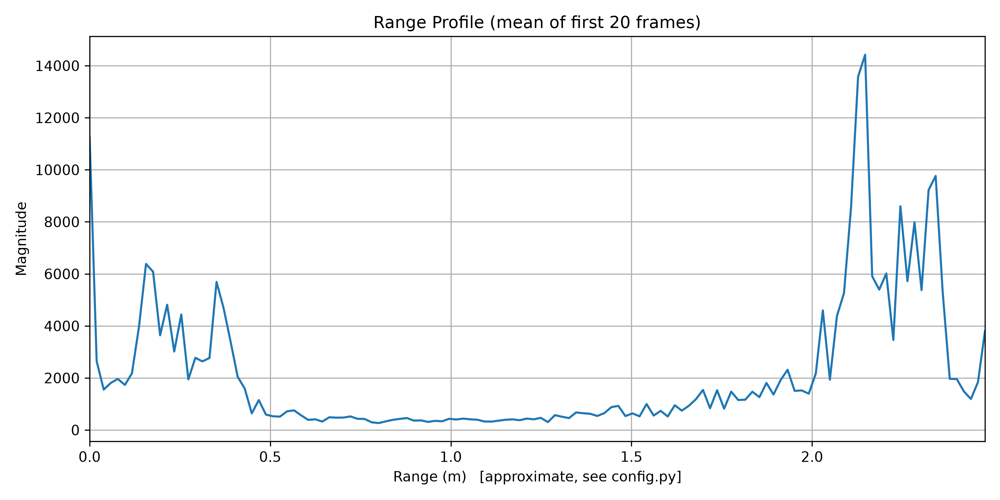
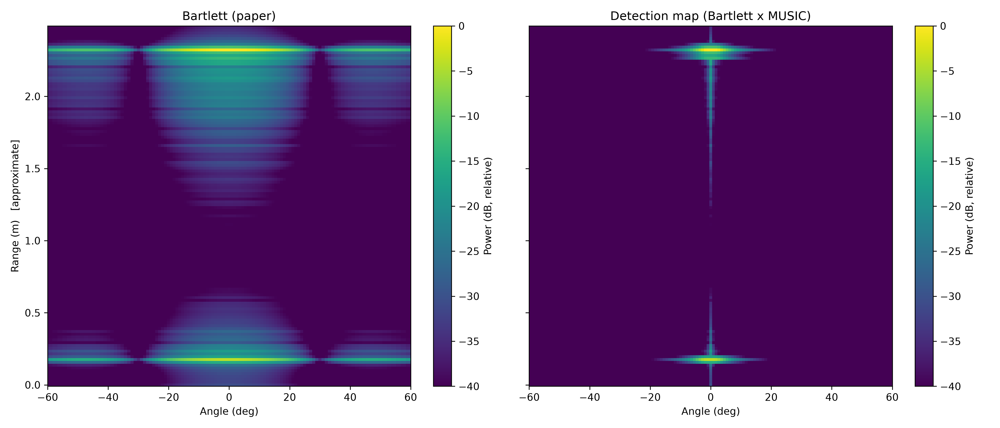

# Non-Contact Multi-Patient Vital Sign Monitoring Using FMCW mmWave Radar

## Project Overview

This project focuses on non-contact monitoring of multiple patients using Frequency-Modulated Continuous-Wave (FMCW) millimeter-wave radar. The objective is to estimate heart rate (HR) and respiration rate (RR) from radar signals without requiring physical contact.

Using the SiViS dataset, the project combines radar signal processing, target localization, beamforming, phase analysis, and Variational Mode Decomposition (VMD) to extract physiological information from multiple targets.

## Key Features

- Non-contact heart rate and respiration rate estimation.
- Range FFT for radar range profiling.
- MUSIC-based range-angle estimation and Bartlett processing.
- Multiple-target detection and MVDR beamforming.
- Phase-based physiological signal extraction.
- VMD-based signal decomposition for heart-rate estimation.
- Performance evaluation against reference physiological values.

## Methodology

The processing pipeline consists of the following stages:

1. **Radar Data Preparation:** Convert radar I/Q samples into a structured radar data cube.
2. **Range FFT:** Transform received radar signals into the range domain.
3. **Slow-Time Processing:** Extract temporal variations associated with target movement.
4. **Range-Angle Estimation:** Generate range-angle maps using MUSIC and Bartlett methods.
5. **Target Detection:** Identify candidate targets from the range-angle map.
6. **MVDR Beamforming:** Extract target-specific radar signals.
7. **Phase Processing:** Analyze phase variations associated with respiration and cardiac activity.
8. **Vital-Sign Estimation:** Apply spectral analysis and VMD to estimate heart rate and respiration rate.
9. **Performance Evaluation:** Compare estimated vital signs against reference values using standard error metrics.

## Visual Results

### Range FFT / Range Profile

*Figure 1: Range profile obtained from the received radar signal.*

### Range-Angle Map

*Figure 2: Range-angle map used for target localization.*

## Experimental Results

The following results were obtained from a representative recording containing two mannequin targets.

### Heart Rate and Respiration Rate

| Target | Condition | Estimated HR (bpm) | Reference HR (bpm) | Estimated RR (breaths/min) | Reference RR (breaths/min) |
|---|---|---:|---:|---:|---:|
| Target 1 | I | 154.80 | 160.00 | 16.15 | 16.00 |
| Target 2 | E | 83.65 | 90.00 | 22.18 | 22.00 |

### Target Localization

| Target | Detected Range (m) | Detected Angle |
|---|---:|---:|
| Target 1 | 2.32 | 0.0° |
| Target 2 | 2.13 | 0.0° |

The strongest peak in the range profile was detected at approximately **2.147 m**.

The detected angle estimates require further validation because both targets were localized at 0°, whereas the recording configuration specifies a 45° angle.

## Performance Evaluation

The evaluation script reported the following metrics for the two target estimates:

| Metric | Heart Rate | Respiration Rate |
|---|---:|---:|
| RMSE | 5.80 bpm | 0.17 breaths/min |
| MAE | 5.77 bpm | 0.16 breaths/min |
| MAPE | 5.15% | 0.88% |

These results indicate promising preliminary agreement with the reference vital signs. However, the metrics are based on only two target estimates from one recording and do not establish performance across the complete dataset.

## Technologies Used

- **Programming Language:** Python
- **Numerical Processing:** NumPy and SciPy
- **Visualization:** Matplotlib
- **Radar Signal Processing:** Range FFT, MUSIC, Bartlett, and MVDR beamforming
- **Signal Decomposition:** Variational Mode Decomposition (VMD)
- **Performance Evaluation:** RMSE, MAE, and MAPE
- **Development Environment:** Visual Studio Code

## Future Scope

- Improve target localization and multi-target separation.
- Enhance heart-rate extraction in the presence of respiration harmonics and signal interference.
- Validate the radar transmitter and chirp configuration.
- Evaluate the system across additional recordings, distances, angles, and physiological conditions.
- Compare MUSIC and MVDR performance under different target configurations.
- Explore machine learning and quantum machine learning for physiological signal analysis.

## Conclusion

This project establishes a signal-processing pipeline for non-contact multi-target heart-rate and respiration-rate estimation using FMCW mmWave radar. Initial results show promising agreement with reference physiological values for two targets. Further validation is required to improve localization accuracy, establish the reliability of heart-rate extraction, and evaluate the system across different recordings and experimental conditions.

## Author

<strong>Deepraj Kashyap</strong> 
<strong>Mayur Ranjan</strong> 
<strong>Mannate Jain</strong> 
Electronics and Communication Engineering 
NIT Silchar